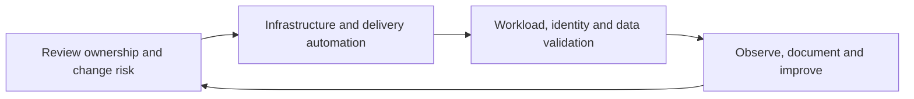

<h1 align="center">Ahmed ElMahdy</h1>
<h3 align="center">Platform / DevOps Engineer</h3>

<p align="center">
  <a href="https://ahmed-el-mahdy.github.io"></a>
  <a href="mailto:a.elmahdy.mail@gmail.com"></a>
  <a href="https://linkedin.com/in/ahmed-el-mahdy-007"></a>
  <a href="https://www.credly.com/users/ahmed-el-mahdy-mohammad/badges"></a>
</p>

---

### About Me

Cloud & DevOps Engineer working with **Azure** and **AWS**. I focus on Kubernetes operations, Terraform, controlled migrations and repeatable delivery for inherited platforms.

At Mosadad, my platform scope includes **six .NET backend services on AKS**, **two App Service portals**, and separate Functions and VM payment deployment paths. My experience spans infrastructure ownership, network/identity troubleshooting, data migration, API publishing and observability.

### Selected Delivery Experience

- Delivered phased staging2 migration work for six backends and two portals, with immutable images, direct-backend checks and service-by-service API cutover.
- Replicated **91,724 application blobs** across three containers with exact name/size parity at the recorded checkpoint, read-only source access and no-delete target permissions.
- Verified an **18-key Key Vault/CSI contract** and removed temporary vault-scoped operator access after validation.
- Standardized workflows across **six repositories and four branches**, validating **18 promotion merge paths**, then added a five-branch source-contract guard for a later build regression.
- Modernized the MongoDB-compatible data path in separate migration stages and made APIM Swagger publishing repeatable rather than dependent on manual release repair.

[CV, measured outcomes and delivery evidence](https://ahmed-el-mahdy.github.io/). Reviewed 30 October 2026; figures describe dated delivery evidence, not current live inventory, guaranteed uptime or tested regional recovery.

### Experience Reference

| Period | Role and context | Focus |
| --- | --- | --- |
| 2026 - Present | Platform/DevOps Engineer, Julfar | Client platforms including Mosadad; migrations, Terraform, AKS, secure delivery and API automation |
| 2021 - 2025 | System Administrator, Julfar | Systems/cloud operations, automation, CI/CD support and incident response |
| 2024 - 2025 | DEPI - MCIT internship | Collaborative AWS application and infrastructure delivery |
| 2022 - 2023 | MCIT and Udacity training | AWS infrastructure and CircleCI delivery lifecycle |
| 2019 - 2020 | Infrastructure and Systems, Shatta | Virtualization, networking, secure connectivity and monitoring |

Mosadad is client delivery under Julfar. My ActionAI onboarding reference covers one service across three environments. Public examples below demonstrate implementation patterns; they are not employer production repositories.



---

### Certifications

<p align="center">
  
  
  
  
  
</p>

---

### Tech Stack

<p align="center">
  
  
  
  
  
  
  
  
  
  
  
  
  
  
  
</p>

---

### Featured Repositories

| Repository | Description | Stack |
|:-----------|:------------|:------|
| [**azure-aks-platform**](https://github.com/ahmed-el-mahdy/azure-aks-platform) | Five-module Terraform reference with a dev composition; not a complete production landing zone | `Terraform` `Azure` `AKS` |
| [**kustomize-multi-env-k8s**](https://github.com/ahmed-el-mahdy/kustomize-multi-env-k8s) | Three workloads with dev/prod overlays and CSI references | `Kustomize` `K8s` `CSI` |
| [**github-actions-reusable-workflows**](https://github.com/ahmed-el-mahdy/github-actions-reusable-workflows) | DRY CI/CD templates: build, scan, deploy to AKS, APIM import | `GitHub Actions` `Docker` `ACR` |
| [**argocd-helm-deployments**](https://github.com/ahmed-el-mahdy/argocd-helm-deployments) | One API with dev/prod Helm values, automatic dev reconciliation and manual prod sync | `ArgoCD` `Helm` `GitOps` |

---

### What I Do

```yaml
Platform Engineering:
  - Design multi-environment Azure infrastructure (Hub-Spoke, AKS, APIM)
  - Write production Terraform modules with state management & drift detection
  - Build DRY CI/CD pipelines (GitHub Actions reusable workflows)
  - Implement GitOps with ArgoCD + Helm for microservice deployments
  - Secure delivery: Key Vault CSI, Entra RBAC, WAF, network segmentation

Day-to-Day:
  - Operate environment-specific AKS workloads and their application dependencies
  - Ship .NET 8 microservices with Angular frontends
  - Monitor with Prometheus + Grafana + Application Insights
  - Stabilize inherited platforms through reviewed plans and measured validation gates
```

---

### GitHub Stats

<p align="center">
  
  
</p>

---

<p align="center">
  <i>Open to Senior DevOps / Platform Engineer / Cloud Architect roles — Remote, UAE, KSA, or Egypt</i>
</p>
